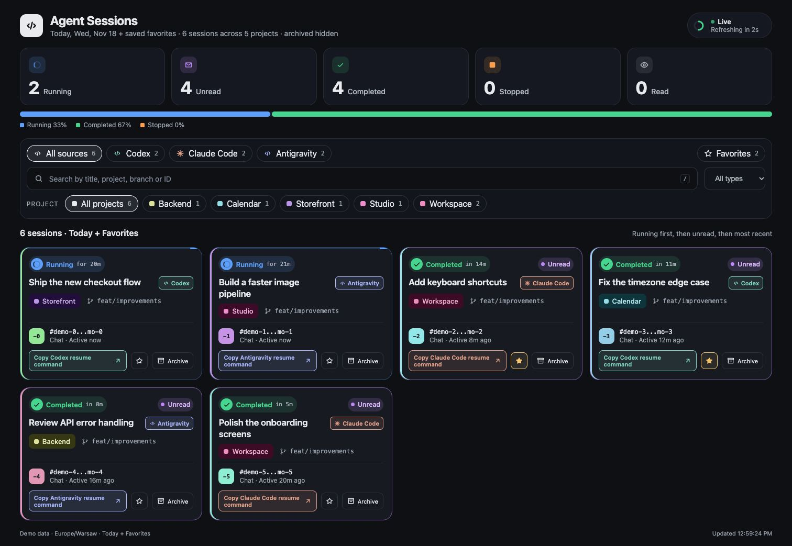

# Agent Sessions

**Your coding agents, in one quiet place.** A local dashboard and desktop tray for
Codex, Claude Code, and Antigravity. See today's work, keep favorites across days,
and get a notification when an agent finishes.

[Download](https://github.com/DenysIvko/agent-sessions/releases/latest) ·
[Website](https://denysivko.github.io/agent-sessions/) ·
[Report an issue](https://github.com/DenysIvko/agent-sessions/issues)



## What you get

- **New, All, Favorites.** New combines running work with finished results awaiting review.
- **A compact tray.** Native AppKit on macOS and a Windows tray with a compact Qt panel.
- **The full dashboard.** Search, project filters, status counts, stable identity colors, and animated running indicators.
- **Completion notifications.** Real operating-system notifications. Finishing work never opens the panel.
- **Favorites that stay.** Keep a session visible after midnight until you remove its star.
- **Archive that works locally.** Hide a session from every Agent Sessions view immediately, even when source archival fails.
- **GitHub release updates.** Automatic version checks and an installer download action.
- **No account, API key, or cloud sync.** Session metadata stays on your computer.

## Install

Download the installer for your computer from [GitHub Releases](https://github.com/DenysIvko/agent-sessions/releases/latest).
Python and runtime libraries are included. Install your preferred coding agents separately.

| Platform | Download | Installation |
| --- | --- | --- |
| macOS 13+ on Apple Silicon | `Agent-Sessions-macOS-arm64.dmg` | Open the disk image, drag Agent Sessions to Applications, then launch it. |
| macOS 13+ on Intel | `Agent-Sessions-macOS-x64.dmg` | Same steps, using the Intel download. |
| Windows 10/11 x64 | `Agent-Sessions-Windows-x64-Setup.exe` | Run the per-user installer. No administrator access or Python setup is needed. |

Initial preview packages are **not signed with a trusted publisher certificate**.
macOS Gatekeeper and Windows SmartScreen may show an unknown-publisher warning.
Only install a package you trust. Check its SHA-256 against the release's
`SHA256SUMS.txt`; organizations that require signed software should build/sign it
with their own certificate or wait for signed releases.

Launch the app, allow notifications if wanted, and click its menu bar or tray icon.
**Open Web Dashboard** opens the larger interface at `http://127.0.0.1:4318`.
The app does not add itself to startup automatically.

## Sources and behavior

| Source | Reads | Open session | Source archive |
| --- | --- | --- | --- |
| Codex desktop | Local threads, latest turn, project and read state | Codex conversation link | Attempts the installed `codex archive` command |
| Claude Code | CLI transcripts and desktop metadata | Claude desktop resume/import link | macOS only, when existing Accessibility permission allows the native helper |
| Antigravity App 2.x | Local `conversation_summaries.db` metadata and indexed archive markers | Copies `agy --conversation <id>` | Local hide only |

Today means activity in **your computer's local timezone**, including an active
run that began yesterday. Project names are used as supplied; there are no
organization-specific grouping rules. Favorite sessions remain available across days.

Antigravity support targets its App 2.x summary index. The older IDE's encrypted
protobuf-only storage and remote-host sessions are not supported. Antigravity and
Claude do not expose a read receipt through these readers; the tray tracks completion
and review locally. Unknown states stay unknown instead of being reported as successful.

Running status combines saved turn state with live process/file metadata. An upstream
format change or restricted process access can make a source unavailable or leave
running state uncertain. The app keeps the last successful snapshot per source.
On Windows, native Windows sessions are supported; sessions inside WSL are not scanned.

## Archive and privacy

Archive first writes a local hidden-session record. It applies to the tray,
web dashboard, and Favorites, and survives restarts. Idle Codex and macOS Claude
sessions then get a best-effort source archive attempt. Source failures are silent.
Running work is hidden locally without stopping it. Source confirmation dialogs
are never accepted automatically. Restoring in a source app does not remove the
local hidden record.

The local HTTP server binds only to `127.0.0.1`. Mutations require a same-origin
JSON request with a custom header. It exposes selected session metadata, not a
transcript download API or arbitrary filesystem access. The Claude reader parses
transcripts locally to determine activity and titles. Credential files are not read.
There is no telemetry. Update checks contact only GitHub's public Releases API and
send no session information. Downloading an update uses GitHub's asset hosting.
See [data locations and troubleshooting](docs/troubleshooting.md).

## Updates and releases

`VERSION` is the single version source and follows `MAJOR.MINOR.PATCH`.
The app checks GitHub on startup and every six hours, ignoring drafts, prereleases,
and older versions. A notification and tray menu action offer the correct installer.
**Installation is user initiated**; the app does not silently replace itself.
Reinstalling preserves favorites, archives, and review state.

A merged version change runs the [release workflow](.github/workflows/release.yml):
build and test on macOS Apple Silicon, macOS Intel, and Windows; package installers;
then publish `vX.Y.Z` with SHA-256 checksums. Published version assets are never overwritten.
The website deploys from `main` through GitHub Pages. PR builds provide review artifacts
without publishing a release. See [release instructions](docs/releasing.md).

## Develop

Python 3.13+, Node.js 22+ for frontend tests, and Xcode command-line tools for macOS.

```sh
python3 -m venv .venv
.venv/bin/python -m pip install -r requirements-build.txt
.venv/bin/python server.py --open
```

On Windows use `.venv\Scripts\python` and install `requirements-windows.txt`.
Run `python windows/app.py` for the Windows tray.

```sh
python -m unittest discover -v
node --test test_colors.mjs test_sessions.mjs
python scripts/package_macos.py    # on a Mac
python scripts/package_windows.py  # on Windows, then compile windows/installer.iss
```

For a read-only demo with fictional data, run `python server.py --demo --port 4319`.
Public screenshots use this demo, never personal conversations. UI checks exercise
the actual native controls, tabs, and archive callbacks without opening source apps.
Antigravity tests use a temporary SQLite database. Archive and update tests use mocks.

## License

MIT. Bundled dependencies retain their own licenses; see
[third-party notices](THIRD_PARTY_NOTICES.md). Agent Sessions is an independent
community project, not affiliated with OpenAI, Anthropic, or Google.
